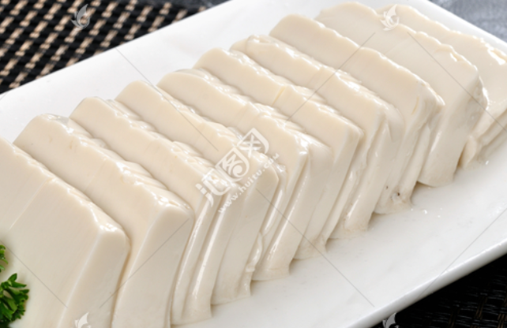
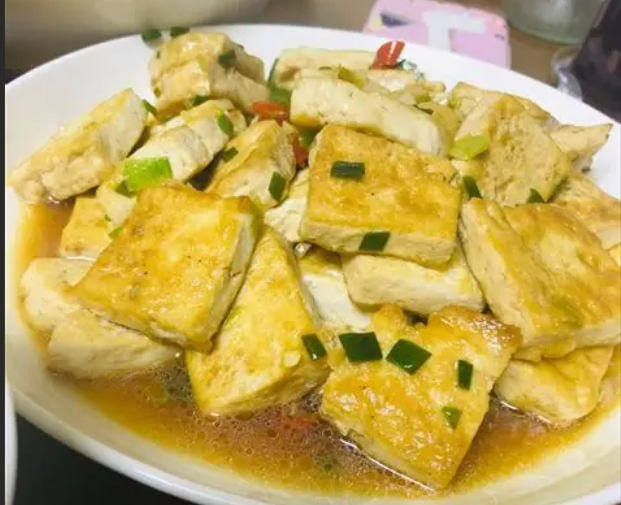
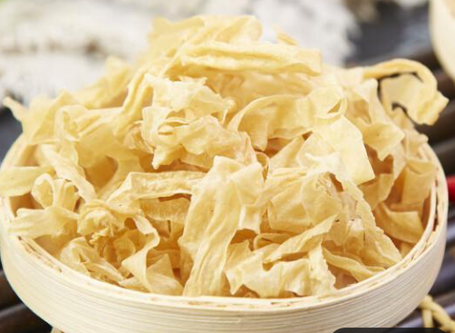
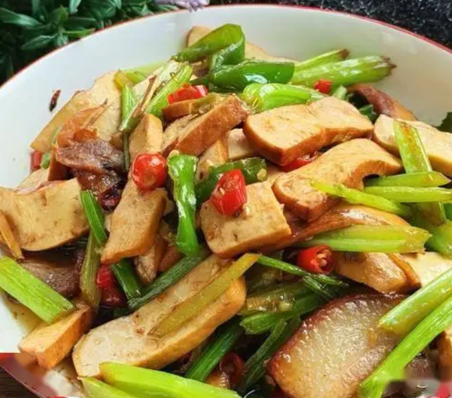
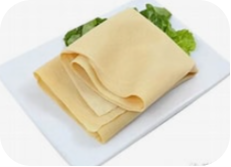
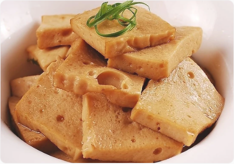
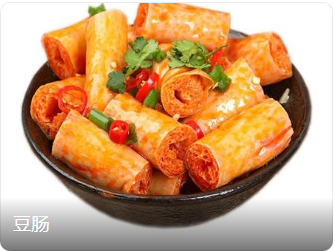
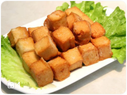

​	日常生活中，会遇见许许多多的豆制类的食物，而每当在食堂点餐时，面对它们，脑海中只有豆腐俩字。于是便只能用手从自己的视角指指点点，希冀于打菜人能看懂。
​	本文便来对这个多样的豆腐，进行一个常见的分类。这样不至于在点餐时搞混（比如我点千页豆腐时，误以为是那种好吃的煎豆腐以至于全部浪费）。

# 基础类

## 嫩豆腐

又称南方豆腐。其含水量多，白白嫩嫩，软软滑滑，容易碎。常用做：麻婆豆腐、豆腐羹等。

## 老豆腐

又称北方豆腐、硬豆腐、板豆腐。水分含量少，口感偏硬。适合煎或者炒。

# 豆浆类

其是用榨豆浆的机器制作（可以在家中简单制作）有：

- **豆浆**

- **豆腐脑**

- **豆渣**
- **腐竹**

- **豆皮**

​	

# 加工类

## 香干

又称：豆干、豆腐干

样貌如下

## 千张

也是比较常见的一种配菜。点外卖比如一些煲类很容易见到。

## 千页豆腐

其并不是传统豆腐，而是用现代机器合成的。个人感觉并不是很好吃。一不入味、二

## 油豆腐

又称豆腐泡

吃火锅、平时做菜都很常见。可搭配红烧肉等。

## 豆肠

有时吃火锅、麻辣烫等会容易看到。

# 其他

本分类是一些无关的，和豆腐有些类似的食物。

## 面筋

其本身是用面粉制作而成的。放到本篇中原因不详，可能是因为颜色类似。

## 鱼豆腐

其主要成分是用鱼肉做的。

